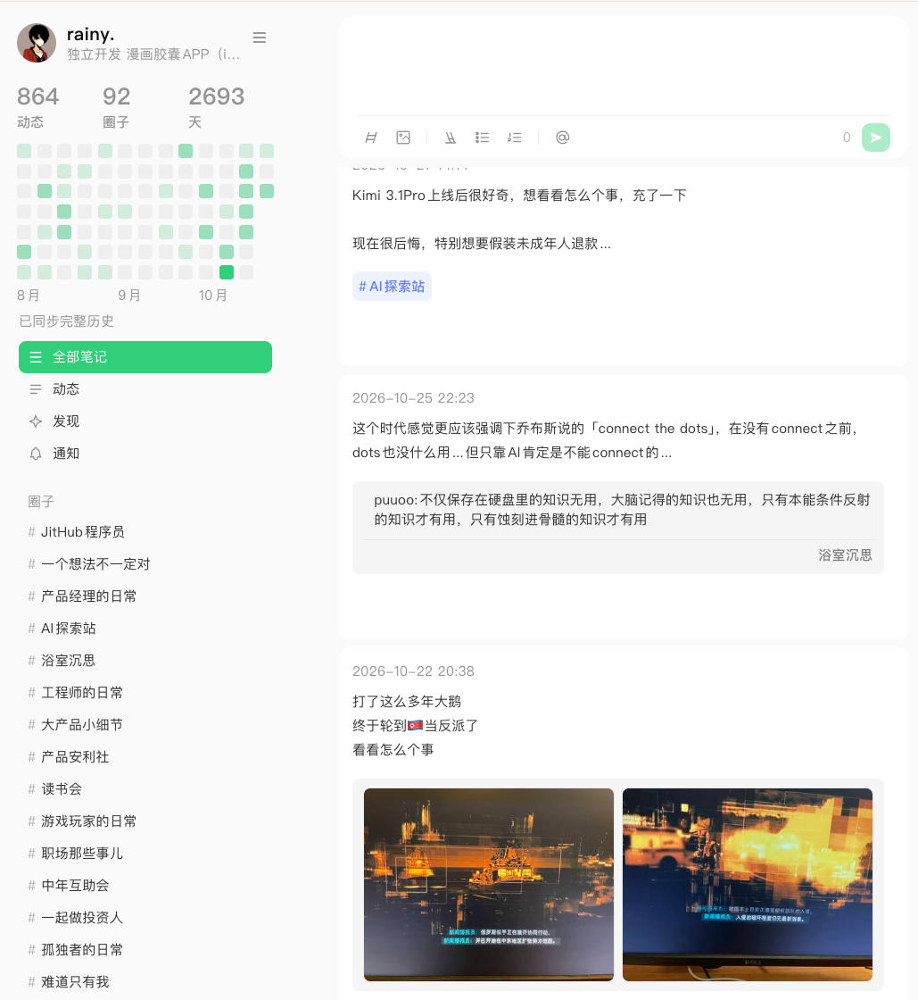
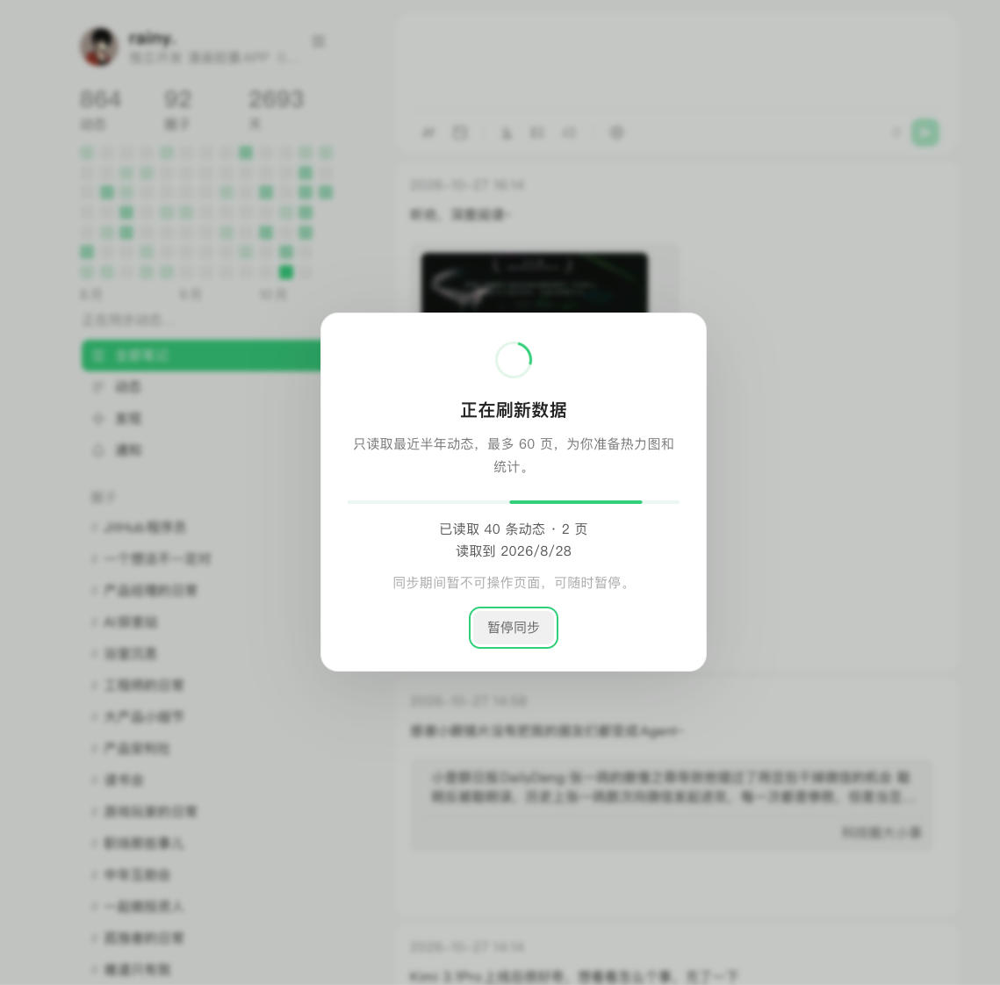

# Jike → Flomo

把即刻网页版变成 flomo 风格的 Chrome 扩展：用笔记卡片浏览自己的动态，也能直接记录和发送新想法。

## 功能

- flomo 风格双栏布局，个人资料、统计和发帖热力图。
- 输入框聚焦展开，支持文字、图片粘贴/选择、附件删除和本地草稿。
- 输入 `@` 搜索并选择即刻用户；支持自动圈子推荐和 `#` 搜索圈子。
- 支持方向键、Enter/Tab 选择，用户引用和所选圈子随草稿保存。
- 首次同步最近半年动态，最多 60 页，显示进度并支持暂停。
- 数据菜单提供「快速刷新」「全量刷新」「清除数据」。
- 点击工具栏图标一键切换：黄色开启、灰色关闭，切换后自动刷新即刻页面。

## 界面预览

**动态变成笔记卡片**：左侧展示个人资料、统计、热力图和圈子，右侧记录想法、浏览历史动态。



**同步进度清晰可见**：初始化和刷新时显示已读取的条数、页数和日期，支持暂停。首次只读取近半年，最多 60 页；完整历史可通过「全量刷新」获取。



**发帖时直接 @ 用户**：输入 `@` 显示候选用户，继续输入昵称搜索；也支持自动圈子推荐和 `#` 搜索圈子。


## 安装

1. 前往 [Releases](https://github.com/xiaotianhu/jike-flomo/releases/latest) 下载最新的 `jike-flomo-v*.zip` 安装包并解压；也可以下载本仓库源码。
2. 打开 Chrome 的 `chrome://extensions`，开启「开发者模式」。
3. 点击「加载已解压的扩展程序」，选择 **`jike-flomo-ext` 文件夹**。
4. 打开并登录 [即刻网页版](https://web.okjike.com/)，等待首次初始化完成。

更新代码后，在扩展管理页点击「重新加载」，再刷新即刻页面。

## 数据与实现

无后端，动态缓存和图文草稿保存在本机浏览器中。读取页面现有数据并复用即刻原生分页、上传和发送流程。「清除数据」只清除本地统计缓存，不删除即刻动态，也不清除草稿。

目前主要适配个人主页；即刻页面结构变化可能影响兼容性。圈子选择与即刻一致，每条动态选择一个圈子。

## 开发

不需要构建。开发时可运行 `jike-flomo-ext/inject.sh` 热注入到已打开的即刻页（需要 `browser-harness`）。

```sh
node jike-flomo-ext/tests/data-sync.test.js
```

更多实现和调试说明见 [开发文档](jike-flomo-ext/README.md)。
